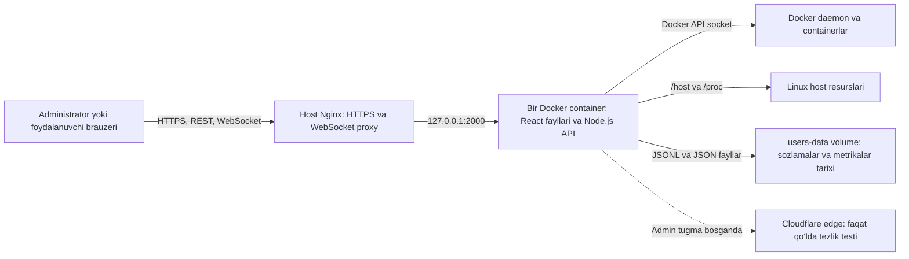

# Logs loyihasi: qanday ishlaydi

Bu hujjat `Husniddin989/logs` loyihasining asosiy qismlarini, Docker loglari qanday ko‘rsatilishini va yangi Monitor bo‘limi metrikalarni qanday yig‘ishini tushuntiradi.

## Qisqacha arxitektura

Production’da React frontend, Node.js API va WebSocket serveri bitta `docker-log-viewer` container ichida ishlaydi. Domen oldidagi host Nginx HTTPS’ni qabul qilib, so‘rovlarni host mashinadagi `127.0.0.1:2000` portiga uzatadi.



Production Compose’dagi `app` xizmati `backend/Dockerfile` orqali yig‘iladi: avval frontend production fayllariga build qilinadi, so‘ng ular backend image’iga qo‘shiladi. Ilova container ichida `2001` portida tinglaydi; Compose uni hostdagi `127.0.0.1:2000` portiga bog‘laydi. Host Nginx sozlamasi uchun [NGINX_SETUP.md](../NGINX_SETUP.md) ga qarang.

## Asosiy papkalar

| Yo‘l | Vazifasi |
|---|---|
| `frontend/src/App.js` | Kirish, foydalanuvchi sessiyasi, containerlar va sahifalar orasidagi boshqaruv |
| `frontend/src/components/LogViewer.js` | Tanlangan container loglarini ko‘rsatish |
| `frontend/src/components/MonitorDashboard.js` | Server va container resurslari, vaqt oralig‘i va tezlik testi UI’i |
| `backend/src/app.js` | REST API, autentifikatsiya/ruxsatlar va WebSocket log oqimi |
| `backend/src/dockerLogs.js` | Docker log oqimini stdout/stderr ramkalaridan log qatorlariga ajratish |
| `backend/src/metrics.js` | Host va container resurslarini o‘qish, CPU/RAM/network qiymatlarini hisoblash |
| `backend/src/metricsHistory.js` | Metrikalarni har daqiqada yig‘ish, tarixga yozish va eski yozuvlarni o‘chirish |
| `backend/src/networkSpeedTest.js` | Admin qo‘lda boshlaydigan server internet tezligi testi |
| `backend/src/tokens.js`, `userStore.js`, `access.js` | JWT sessiyalar, foydalanuvchilar va container bo‘yicha ruxsatlar |
| `docker-compose.yml` | Production’dagi yagona ilova container’i, host mountlari va doimiy volume |

## Container loglari qanday keladi

1. Brauzer foydalanuvchi tokeni bilan `GET /api/containers` chaqiradi. Backend Docker daemon’dan container ro‘yxati va holatini oladi. Oddiy foydalanuvchiga faqat biriktirilgan containerlar qaytariladi.
2. Container tanlanganda tarixiy yoki qidiruv natijali loglar `GET /api/containers/:id/logs` orqali olinadi. Backend foydalanuvchining aynan shu container’ga ruxsatini tekshiradi, Docker’dan kerakli vaqt oralig‘ini oladi, matn bo‘yicha qidiruv va sahifalashni qo‘llaydi.
3. Jonli ko‘rish uchun brauzer `/ws` WebSocket’iga ulanadi, avval `auth` xabarida JWT yuboradi, keyin `subscribe` xabarida container ID’ni so‘raydi. Backend ruxsatni tekshirib, Docker log oqimini brauzerga uzatadi. Oqim stdout va stderr’ni ajratadi.
4. Sessiya va container ruxsati WebSocket ishlayotgan paytda qayta tekshiriladi. Ruxsat o‘zgarsa yoki sessiya bekor bo‘lsa oqim yopiladi.

Ilova Docker’ning mavjud loglarini o‘qiydi; loglarni alohida ilova bazasiga ko‘chirmaydi. Qancha eski logni ko‘rish mumkinligi Docker hostidagi log driver va uning saqlash siyosatiga ham bog‘liq. `Clear` tugmasi ko‘rinayotgan ro‘yxatni tozalaydi, Docker’dagi log fayllarini o‘chirmaydi.

Vaqt filtrlari: live, 5/15/30 daqiqa, 1/3/6/12/24 soat, 3 yoki 7 kun va qo‘lda sana oralig‘i. Monitor tarixi bundan alohida: u faqat oxirgi 72 soatni saqlaydi.

## Kirish va ruxsatlar

- Kirishda backend login va parolni tekshiradi, so‘ng qisqa muddatli JWT beradi. Standart sozlamada access token 15 daqiqa, sessiyaning maksimal umri 12 soat; brauzer tokenni muddati tugashidan oldin yangilaydi.
- Birinchi ishga tushishda `ADMIN_INITIAL_PASSWORD` bilan admin yaratiladi va birinchi kirishda yangi parol tanlash talab qilinadi. Tayyor, umumiy default parol yo‘q.
- `admin` barcha containerlarni, foydalanuvchilarni, ogohlantirish sozlamalarini va Monitor sahifasini boshqaradi. `user` faqat admin tomonidan ruxsatlangan containerlarni ko‘radi.
- Containerlarni ishga tushirish/to‘xtatish/qayta ishga tushirish/o‘chirish uchun admin parolini qayta kiritib 5 daqiqalik action token olinadi. `CONTAINER_ACTIONS_ENABLED=false` bo‘lsa bu imkoniyat API’da o‘chadi.
- Muhim login, ruxsat rad etilishi va admin amallari audit logiga yoziladi.

## Monitor: joriy qiymatlar va daqiqalik tarix

Backend ishga tushganda `metricsHistory` tarix faylini o‘qiydi, eskirgan yozuvlarni tozalaydi, darhol bir o‘lchov oladi va keyin har 60 soniyada yig‘adi. Tarix monitoring sahifasidagi tanlangan vaqtga qarab API’dan olinadi. UI’da 1 soat, 6 soat, 24 soat, 3 kun yoki maxsus vaqt oralig‘i bor.

### Server ko‘rsatkichlari

| Ko‘rsatkich | Qanday hisoblanadi |
|---|---|
| CPU bandligi | Node `os.cpus()` bergan CPU vaqtlarining ketma-ket namunalari orasidagi farqdan band vaqt foizi olinadi. Birinchi namuna baseline bo‘lgani uchun unda foiz hali yo‘q bo‘lishi mumkin. |
| Tizim yuklamasi | `os.loadavg()` ning 1 daqiqalik qiymati yadro soniga bo‘linib foizga aylantiriladi. Gauge’da foiz, yonida esa xom load qiymati ko‘rsatiladi. |
| RAM | Umumiy xotiradan Linux `MemAvailable` ayriladi; u topilmasa Node bergan bo‘sh xotira qiymatidan foydalaniladi. |
| Swap | Linux `/proc/meminfo` ichidagi `SwapTotal` va `SwapFree` farqidan ishlatilgan swap olinadi. Swap mavjud bo‘lmasa qiymat bo‘sh ko‘rsatilishi mumkin. |
| Disk | `statfs` orqali mount qilingan filesystem o‘lchanadi. Production Compose `/` ni `/host` ga read-only mount qiladi va standart disk yo‘li `/host`; shu sababli host disk ko‘rsatiladi. |
| Server tarmoq trafigi | `/host/proc/net/dev` interfeys hisoblagichlari o‘qiladi. Hisoblagichlarning vaqt bo‘yicha farqi qabul/yuborish tezligini B/s ko‘rinishida beradi. Loopback va Docker virtual interfeyslari chiqarib tashlanadi. |

### Container ko‘rsatkichlari

Har daqiqalik namuna Docker’dan barcha ko‘rinadigan containerlarning holatini oladi. Ishlayotganlari uchun Docker stats qiymatlaridan CPU, RAM va network hisoblagichlari yig‘iladi. Tarixda CPU/RAM grafigi va tarmoq qabul/yuborish tezligi chiziladi. Container qayta yaratilsa uning yangi ID’si tarixda alohida identifikator bo‘ladi.

### Doimiy trafik va internet speed-test farqi

Monitor’dagi **Joriy tarmoq trafigi** server interfeyslarida kuzatilgan real qabul/yuborish oqimini ko‘rsatadi. U internet liniyasining maksimal tezligini sinamaydi.

**Tezlikni o‘lchash** tugmasi esa brauzer emas, backend ishlayotgan serverdan Cloudflare edge’iga so‘rov yuboradi. Cloudflare’ning ochiq speed-test endpointlari (`/__down` va `/__up`) download/upload sinovlari uchun ishlatiladi ([Cloudflare Speedtest tavsifi](https://github.com/cloudflare/speedtest)). Bu Fast.com’ning aynan o‘zi emas: natija serverdan Cloudflare edge’iga bo‘lgan yo‘lni o‘lchaydi, boshqa provayder yoki manzilga tezlik farq qilishi mumkin.

Standart bitta test:

- 4 ta kichik, ketma-ket HTTP so‘rovidan kechikish medianasi olinadi. Bu ICMP ping paketi emas, Cloudflare edge’iga HTTP round-trip vaqti.
- 3 ta parallel `10,000,000` baytli download — jami taxminan 30 MB.
- 3 ta parallel `3,000,000` baytli upload — jami taxminan 9 MB.
- Download/upload Mbps jami bayt va parallel sinovning o‘tgan vaqtiga qarab hisoblanadi. Umumiy trafik taxminan 39 MB.
- Test faqat admin tugmani bosganda boshlanadi. Fon rejimida yoki avtomatik jadval bilan ishlamaydi. Bir vaqtda ikkinchi test qabul qilinmaydi; urinishlar orasida 60 soniya cooldown bor. Xato bo‘lgan urinish ham shu backend jarayoni ichida cooldown’ni boshlaydi.

## Tarix va fayllar qayerda saqlanadi

Production’da quyidagi ma’lumotlar `/app/src/data` ichida; Compose bu papkani `users-data` nomli Docker volume bilan saqlab qoladi:

| Fayl | Nima saqlanadi |
|---|---|
| `users.json` | Foydalanuvchi yozuvlari va parol hash’lari |
| `revoked-tokens.json` | Bekor qilingan sessiyalar |
| `alert-settings.json` | UI’da saqlangan alert sozlamalari |
| `metrics-history.ndjson` | Server va containerlardan har daqiqada olingan namuna, 72 soatgacha |
| `network-speed-tests.ndjson` | Qo‘lda bajarilgan muvaffaqiyatli speed-test natijalari; API va UI faqat 72 soatlik oraliqni ko‘rsatadi |
| `audit.log` | `AUDIT_LOG_FILE` production sozlamasida ko‘rsatilgan audit yozuvlari |

Metrika va tezlik tarixi JSON Lines formatida: har qator alohida JSON namuna. Tarix fayllari servis foydalanuvchisigagina o‘qish/yozish huquqi beriladigan rejimda saqlanadi. Metrika tarixi eskirgan namunalarni har soat tozalaydi. Tezlik testi fayli ishga tushishda va keyingi muvaffaqiyatli testdan so‘ng tozalanadi; API esa 72 soatdan eski natijani qaytarmaydi. Named volume sababli container’ni qayta yaratish tarixni o‘chirmaydi. `docker compose down -v` esa `users-data` volume’ni ham o‘chiradi; tarix va foydalanuvchilarni saqlamoqchi bo‘lsangiz `-v` ishlatmang.

Monitor API:

| So‘rov | Vazifasi |
|---|---|
| `GET /api/monitor/snapshot` | Hozirgi server ko‘rsatkichlari |
| `GET /api/monitor/history?from=<ISO>&to=<ISO>` | Server/container namunalari va tanlangan vaqtga tushadigan speed-test natijalari; maksimum 72 soat |
| `POST /api/monitor/speedtest` | Admin uchun bitta qo‘lda tezlik o‘lchovi |

Barcha Monitor API so‘rovlari admin JWT talab qiladi. `speedtest` natijasi shu POST javobida qaytadi, keyin `history` orqali vaqt oralig‘ida ko‘riladi.

## Telegram ogohlantirishlari

Telegram alert monitoring tarixidan mustaqil servis. Admin Alerts sahifasida server, container va ixtiyoriy Postgres/Redis tekshiruvlarini sozlaydi. Telegram token va chat ID berilgandagina yoqiladi. `ALERT_INTERVAL` bo‘yicha server/container holati tekshiriladi; muammo holati o‘zgarganda, qayta bildirish vaqtida va kunlik summary yuborilishi mumkin. Speed-test avtomatik alert yoki avtomatik tarmoq o‘lchovi emas.

## Ishga tushirish va yangilash

```bash
cp .env.example .env
# .env ichida kuchli JWT_SECRET va bir martalik ADMIN_INITIAL_PASSWORD kiriting
docker compose up -d --build
```

Keyingi yangilashda odatda:

```bash
docker compose up -d --build
```

Holat va ilova loglari:

```bash
docker compose ps
docker compose logs -f app
```

Ilova frontend/API/WebSocket’ni bitta service’da ishlatadi. Nginx TLS bilan domenni shu hostdagi `127.0.0.1:2000` ga proxy qiladi; WebSocket uchun `Upgrade` va `Connection` headerlari uzatilishi kerak. Nginx misoli [NGINX_SETUP.md](../NGINX_SETUP.md) da.

Development’da `docker-compose.dev.yml` backend container’ini ishga tushiradi; React frontendni alohida terminalda `cd frontend && npm start` bilan boshlash mumkin. Production Compose bilan development Compose’ni aralashtirmang.

## Asosiy sozlamalar va eslatmalar

- `FRONTEND_PORT`: host Nginx ulanadigan port, standart `2000`.
- `JWT_SECRET`: majburiy, kuchli va tasodifiy qiymat; almashtirilsa mavjud sessiyalar yaroqsiz bo‘ladi.
- `ADMIN_USERNAME`, `ADMIN_INITIAL_PASSWORD`: birinchi adminni yaratish uchun.
- `CONTAINER_ACTIONS_ENABLED`, `CONTAINER_ACTIONS_PROTECTED`: admin container amallarini boshqaradi.
- `ALERT_*`, `TELEGRAM_BOT_TOKEN`, `TELEGRAM_CHAT_ID`: Telegram ogohlantirish sozlamalari. Ko‘p alert sozlamalarini admin UI’da o‘zgartirish mumkin.

Yangi funksiyalarga tegishli testlar `backend/test/` da, production frontend yig‘ilishi esa `frontend` paketidagi `npm run build` buyrug‘ida.
